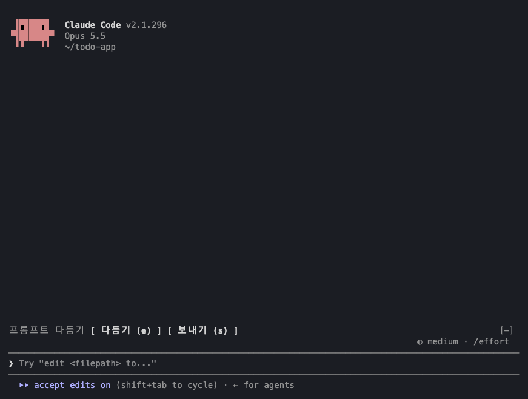
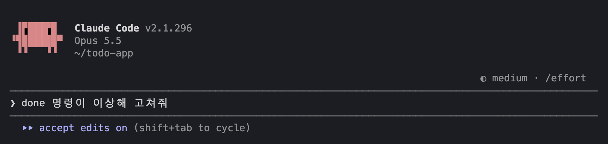
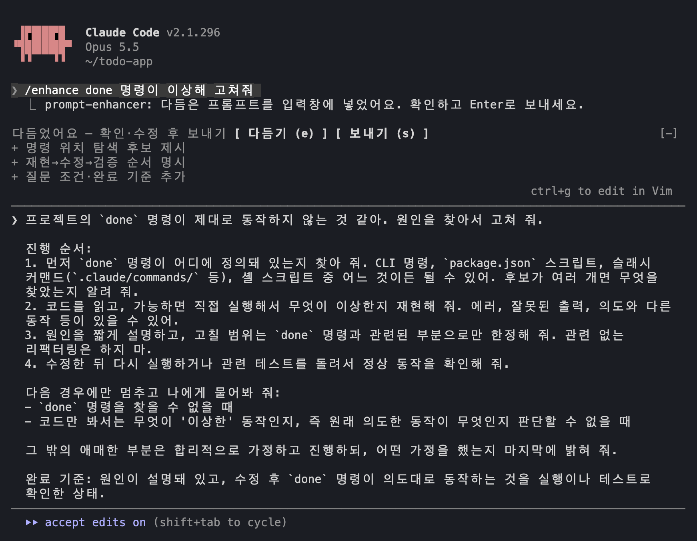
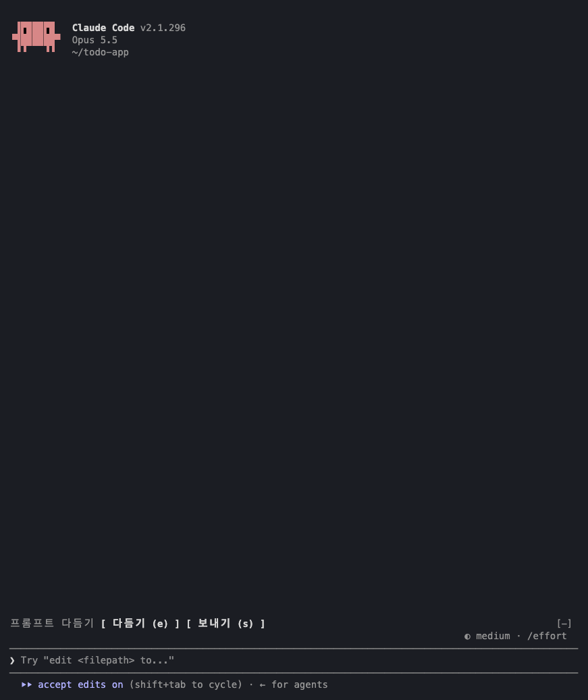
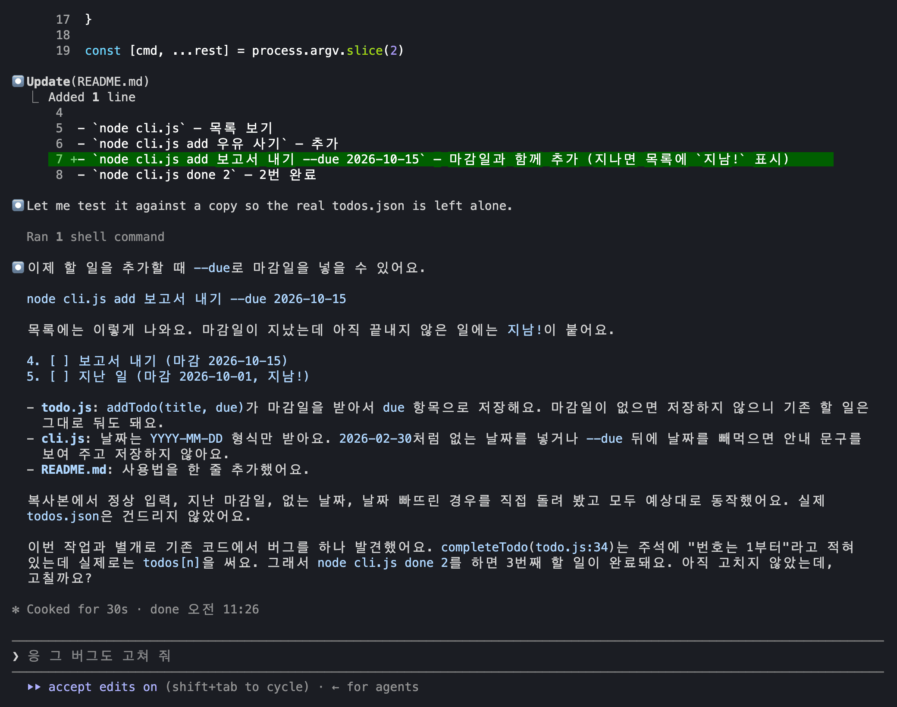
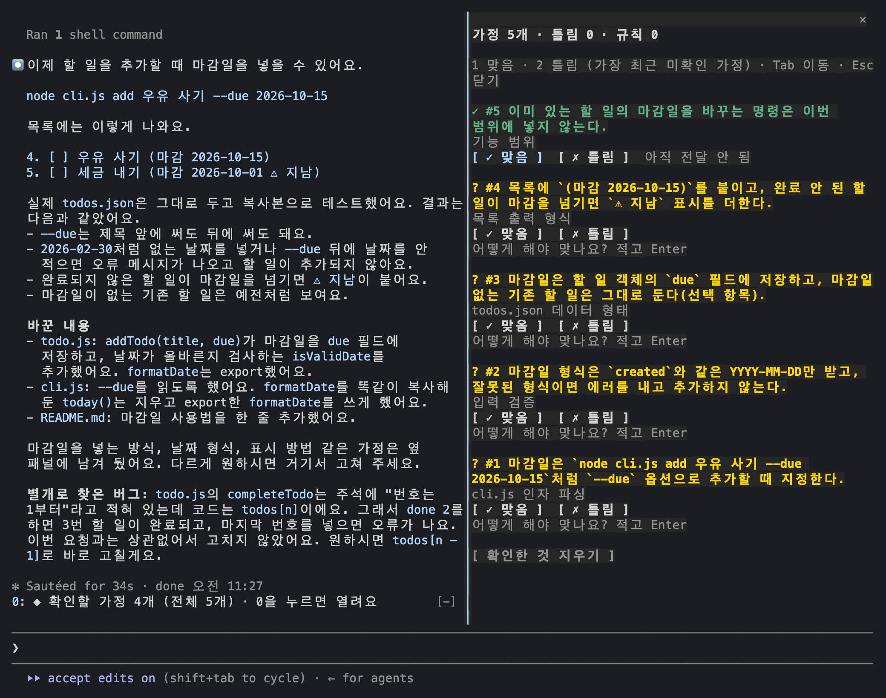
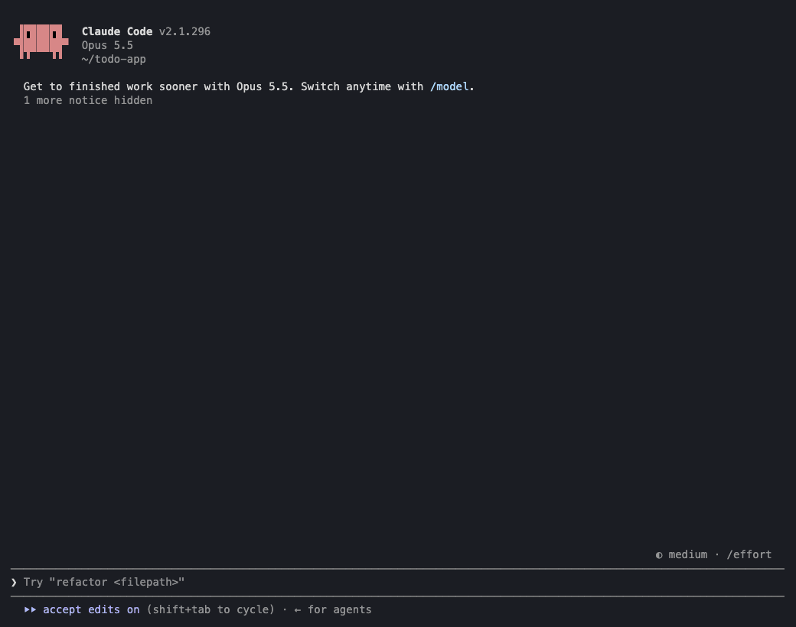
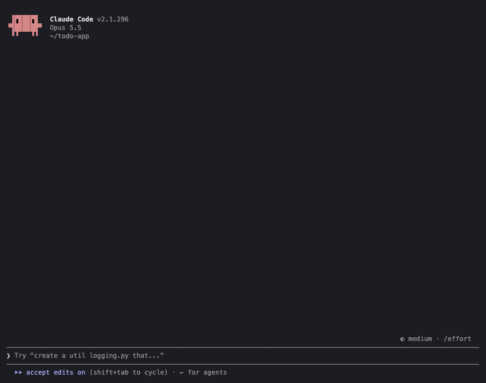

# Claude Code mod 한국어판 (claude-mods-ko)

**Claude Code를 한국어로 쓰는 사람을 위한 mod 2종.** 대충 쓴 요청은 버튼 한 번에 구체적으로, Claude가 혼자 정한 가정은 눈에 보이게.

[](LICENSE)


한국어판 제작: [robinade](https://github.com/robinade)

AI LABS의 Claude Code mod 소개 영상을 보고 영감을 받아 만들었어요.

<p align="center">
  
</p>

## 목차

- [왜 필요한가요](#왜-필요한가요)
- [mod 2종 한눈에 보기](#mod-2종-한눈에-보기)
- [쓰기 전과 후 (before / after)](#쓰기-전과-후-before--after)
- [설치 가이드](#설치-가이드)
- [사용 가이드](#사용-가이드)
- [비용과 필요 조건](#비용과-필요-조건)
- [문제 해결](#문제-해결)
- [mod 고치기](#mod-고치기)
- [라이선스](#라이선스)

## 왜 필요한가요

Claude Code는 강력하지만, 한국어로 하루 종일 쓰다 보면 비슷한 곳에서 자꾸 걸려요.

| 자주 겪는 일 | 그래서 생기는 문제 | 도와주는 mod |
|---|---|---|
| "이거 고쳐줘"처럼 짧게 던지게 돼요 | Claude가 범위와 완료 기준을 멋대로 정해요 | **prompt-enhancer** |
| Claude가 날짜 형식, 명령 이름 같은 걸 혼자 정하고 넘어가요 | 한참 뒤에 "이게 왜 이렇게 됐지?"를 발견해요 | **assumption-tracker** |

여기에 한국어 사용자에게만 생기는 불편도 고쳤어요.

- **한글 폭**: 터미널에서 한글은 2칸을 차지해요. 줄 자르기를 글자 수가 아니라 화면 폭 기준으로 해서 메모 줄이 깨지지 않아요.
- **한글 입력 상태 단축키**: 한글 입력 중에는 `y`, `n` 같은 글자 단축키가 자모(`ㅛ`, `ㅜ`)로 들어가 먹지 않아요. 가정 패널의 키는 숫자(`0`, `1`, `2`)로 바꿨어요.

## mod 2종 한눈에 보기

| mod | 하는 일 | 시작 | 자세히 |
|---|---|---|---|
| **prompt-enhancer** | 대충 쓴 초안을 범위·순서·완료 기준이 있는 프롬프트로 다듬어 입력창에 넣어 줘요. 세션 모델의 프롬프트 가이드 카드도 반영해요. | 입력창 위 띠의 **다듬기 (e)** 또는 `/enhance <초안>` | [README](prompt-enhancer/README.md) |
| **assumption-tracker** | Claude가 작업 중 정한 가정을 한 줄씩 기록해요. 맞음/틀림을 표시하면 정정이 Claude에게 가고, 프로젝트 규칙으로 남아요. | 작업 뒤 빈 입력창에서 **`0`** (또는 `/assumptions`) | [README](assumption-tracker/README.md) |

## 쓰기 전과 후 (before / after)

아래 화면은 모두 데모용 빈 폴더의 작은 할 일 앱(`~/todo-app`)에서 실제로 Claude Code를 실행해 찍었어요. 왼쪽은 mod를 끈 상태, 오른쪽은 그 mod 하나만 켠 상태에서 같은 요청을 보낸 결과예요. Claude의 답은 매번 조금씩 달라요. 이미지를 누르면 크게 볼 수 있어요.

### prompt-enhancer — 대충 쓴 요청을 구체적으로

요청 초안: `done 명령이 이상해 고쳐줘`

<table>
<tr><th width="50%">mod 없이</th><th width="50%">prompt-enhancer 켜고</th></tr>
<tr>
<td></td>
<td></td>
</tr>
<tr>
<td>무엇이 이상한지, 어디까지 고칠지, 언제 끝난 건지 없이 그대로 보내게 돼요.</td>
<td>입력창 위 띠의 <b>다듬기 (e)</b>를 누르면 진행 순서, 막힐 때만 물을 것, 완료 기준을 넣어 입력창을 바꿔 줘요. 위 띠에 무엇을 더했는지 메모가 떠요. 고쳐서 보내거나 그대로 Enter(또는 <b>보내기 (s)</b>)를 누르면 돼요.</td>
</tr>
</table>

#### 쓰는 방법 두 가지

**방법 1 — 입력창에 쓰고 [다듬기 (e)] 누르기** (가장 간단해요)

평소처럼 입력창에 초안을 쓴 다음, 입력창 바로 위 띠의 **[ 다듬기 (e) ]** 를 클릭해요. 키보드로는 `ctrl+x tab`으로 띠에 들어가 `e`나 `Enter`를 눌러요(한글 입력 상태라면 `Enter`가 편해요). 아래 화면이 이 방법이에요.


**방법 2 — `/enhance <초안>` 명령**

명령 한 줄로 바로 다듬어요. 길게 붙여 넣은 글은 입력창에서 `[Pasted text #1 +45 lines]`처럼 접혀 버튼으로는 읽지 못해요. 이때는 `/enhance ` 뒤에 붙여 넣으면 돼요.

<details open><summary>방법 2 화면 보기</summary>

</details>

### assumption-tracker — Claude가 정한 가정을 눈앞에

요청: `할 일에 마감일을 넣을 수 있게 해 줘`

<table>
<tr><th width="50%">mod 없이</th><th width="50%">assumption-tracker 켜고</th></tr>
<tr>
<td></td>
<td></td>
</tr>
<tr>
<td>옵션 이름, 날짜 형식, 표시 방법을 Claude가 정했지만 긴 답 속에 섞여 있어 놓치기 쉬워요.</td>
<td>작업이 끝나면 입력창 위 띠에 <code>◆ 확인할 가정 N개 · 0을 누르면 열려요</code>가 떠요. 빈 입력창에서 <b><code>0</code></b>만 누르면 옆 패널에 정한 가정이 한 줄씩 나와요. <code>1</code>은 맞음, <code>2</code>는 틀림이고, 틀림에 고칠 방법을 적으면 Claude가 그 가정에 기댄 작업을 고쳐요. 정정은 프로젝트 규칙으로 남아 다음 세션에도 적용돼요.</td>
</tr>
</table>

#### 쓰는 방법

**방법 1 — 빈 입력창에서 `0`** (가장 빨라요)

띠에 `0을 누르면 열려요`가 보이면 `0` → 패널이 열려요. 패널에서 `1` 맞음, `2` 틀림, `Esc` 닫기. 숫자 키라 한글 입력 상태에서도 그대로 먹어요.



**방법 2 — `/assumptions` 명령**

띠가 안 보일 때(아직 가정이 없을 때)도 패널을 열 수 있어요.

<details><summary>방법 2 화면 보기</summary>

</details>

## 설치 가이드

설치하면 **prompt-enhancer와 assumption-tracker 두 개가 함께** 깔려요.

### 빠른 설치: AI 에이전트에게 맡기기

아래 **에이전트용 프롬프트**를 복사해 Claude Code(또는 터미널 명령을 실행할 수 있는 다른 AI 에이전트)에 붙여 넣으면, 에이전트가 버전 확인부터 설치와 확인까지 알아서 해요. 직접 설치하고 싶으면 그 아래 **직접 입력할 명령어**를 쓰면 돼요.

에이전트용 프롬프트:

```
Claude Code mod를 설치해 줘. 저장소는 https://github.com/robinade/claude-mods-ko 야.
설치할 mod: prompt-enhancer, assumption-tracker

아래 순서대로 진행해 줘.
1. `claude --version`으로 버전을 확인해. 2.1.295보다 낮으면 `claude update`로 올려.
2. `~/.claude/settings.json`의 `env`에 `CLAUDE_CODE_ATTRIBUTION_HEADER`가 있는지 확인해. 값이 "0"이면 mod가 따로 부르는 모델 호출이 429로 막혀. 그 줄을 지워도 되는지 나에게 먼저 묻고, 허락하면 지워.
3. `claude plugin marketplace add robinade/claude-mods-ko`를 실행해. 이미 추가돼 있다고 나오면 `claude plugin marketplace update claude-mods-ko`로 최신 목록을 받은 뒤 다음 단계로 넘어가.
4. 설치할 mod마다 `claude plugin install <mod 이름>@claude-mods-ko`를 실행해. 설치 범위는 기본값 user(이 컴퓨터의 모든 프로젝트)로 둬.
5. `claude plugin list`로 두 mod가 모두 `@claude-mods-ko`로 보이고 enabled인지 확인해.

지켜 줘.
- `plugin` 명령이 "not run from this spelling"으로 거부되면 `claude`가 다른 프로그램(예: cmux)의 래퍼라서 그래. `which -a claude`로 실제 실행 파일(예: `~/.local/bin/claude`)을 찾아 그걸로 다시 실행해.
- 위 목록에 없는 mod는 설치하지 말고, 2번 말고는 설정 파일을 건드리지 마.

끝나면 설치한 mod와 버전, 건너뛰거나 실패한 단계를 알려 줘. 그리고 Claude Code를 다시 시작하면(또는 `/reload-plugins`) mod가 켜진다고 안내해 줘.
```

직접 입력할 명령어 (터미널에서 `claude`를 실행한 뒤 입력창에):

```
/plugin marketplace add robinade/claude-mods-ko
/plugin install prompt-enhancer@claude-mods-ko
/plugin install assumption-tracker@claude-mods-ko
```

#### 직접 설치할 때 알아 둘 것

- 시작 전에 [1. 준비](#1-준비)의 버전과 설정을 먼저 확인하세요.
- 첫 줄 `/plugin marketplace add`는 이 레포를 mod 목록으로 등록해요. 컴퓨터마다 한 번이면 돼요. 이미 등록돼 있으면 건너뛰어요.
- `/plugin install`을 입력하면 설치 범위를 고르는 화면이 떠요. 맨 위의 `user`에 두고 Enter를 누르세요.
- 터미널 명령으로 하려면 앞의 `/plugin`을 `claude plugin`으로 바꿔요. 예: `claude plugin install assumption-tracker@claude-mods-ko`
- 설치가 끝나면 [3. 잘 깔렸는지 확인](#3-잘-깔렸는지-확인)으로 확인해요.

아래 1~5는 같은 설치를 한 단계씩 자세히 설명한 거예요.

### 1. 준비

1. **Claude Code 버전 확인** — 2.1.295 이상이어야 해요.
   ```
   claude --version
   claude update        # 낮으면 올려요
   ```
2. **설정 하나 확인** — `~/.claude/settings.json`의 `env`에 `CLAUDE_CODE_ATTRIBUTION_HEADER: "0"`이 있으면 지워요. 있으면 prompt-enhancer가 따로 부르는 모델 호출이 `429`로 막혀요([문제 해결](#문제-해결) 참고).
   ```
   grep -n CLAUDE_CODE_ATTRIBUTION_HEADER ~/.claude/settings.json   # 아무것도 안 나오면 괜찮아요
   ```
3. **터미널에서 진행** — 설치 명령은 터미널의 Claude Code에서만 받아요. 데스크톱 앱의 Code 탭에서는 쓸 수 없지만, 터미널에서 `user` 범위로 설치하면 데스크톱 앱의 로컬 세션에서도 켜져요.

### 2. 설치

터미널에서 `claude`를 실행하고, 입력창에 두 줄을 차례로 입력해요.

```
/plugin install prompt-enhancer --marketplace robinade/claude-mods-ko
/plugin install assumption-tracker --marketplace robinade/claude-mods-ko
```

1. 처음 한 번은 `Add marketplace?`(`github:robinade/claude-mods-ko`)를 물어요. `y`를 눌러요.
2. 설치 범위를 고르는 화면에서 맨 위의 `user`에 두고 Enter를 눌러요. `user` 범위는 이 컴퓨터의 모든 프로젝트에서 켜져요.
3. `Installed <mod>. Plugin is now active.`가 나오면 끝이에요. 그 세션에서 바로 켜지고, 이후 여는 세션에서도 켜져요.

터미널 명령으로 두 개를 한 번에 설치할 수도 있어요.

```
claude plugin marketplace add robinade/claude-mods-ko
for m in prompt-enhancer assumption-tracker; do
  claude plugin install $m@claude-mods-ko
done
```

`claude`를 감싸는 래퍼(예: cmux) 안에서 `plugin` 하위 명령이 거부되면, `which -a claude`로 실제 실행 파일을 찾아 그걸로 실행하세요(예: `~/.local/bin/claude`).

### 3. 잘 깔렸는지 확인

```
claude plugin list        # 2개가 @claude-mods-ko 로 보이고 enabled 이면 성공
```

새 세션을 열고 아래를 하나씩 해 봐요. 띠의 버튼은 클릭하거나 `ctrl+x tab` → `Enter`로 눌러요.

| 해 볼 것 | 이렇게 되면 정상 |
|---|---|
| 입력창에 `로그인 버그 고쳐줘`를 쓰고 띠의 **다듬기 (e)** (또는 `/enhance 로그인 버그 고쳐줘`) | 다듬은 프롬프트가 입력창에 들어오고, 띠에 무엇을 더했는지 메모가 떠요 |
| 작은 작업을 시킨 뒤 빈 입력창에서 `0` (또는 `/assumptions`) | 옆에 가정 패널이 열려요. 띠가 없으면 아직 기록된 가정이 없는 거예요 |

### 4. 업데이트

```
claude plugin marketplace update claude-mods-ko
claude plugin update prompt-enhancer@claude-mods-ko
claude plugin update assumption-tracker@claude-mods-ko
```

- 첫 줄은 이 레포의 최신 mod 목록을 받아 와요. 나머지 줄은 mod를 새 버전으로 바꿔요.
- 업데이트한 뒤에는 Claude Code를 다시 시작해요.
- 예전에 이 레포에서 다른 mod(plain-talk, idea-shelf, session-monitor, session-tracker)를 설치했다면, 이제 레포에서 빠졌으니 `claude plugin uninstall <이름>@claude-mods-ko`로 지워 주세요.

### 5. 끄기·켜기·지우기

```
claude plugin disable <이름>@claude-mods-ko
claude plugin enable <이름>@claude-mods-ko
claude plugin uninstall <이름>@claude-mods-ko
```

### 설치 없이 한 세션만 써 보기

```
git clone https://github.com/robinade/claude-mods-ko
claude --plugin-dir claude-mods-ko/prompt-enhancer --plugin-dir claude-mods-ko/assumption-tracker
```

## 사용 가이드

### 공통

- **명령**: `/`를 치면 mod 명령이 기본 명령과 같이 보여요. 명령 이름은 영어지만 뒤에 붙이는 내용은 한국어로 써도 돼요.
- **입력창 위 띠(밴드)와 버튼**: 입력 중에는 키가 입력창으로 가요. `ctrl+x tab`(또는 띠 클릭)으로 띠에 포커스를 옮기고, `Tab`으로 버튼 사이를 이동, `Enter`로 누르고, `Esc`로 입력창에 돌아가요.
- **한/영 전환 주의**: 버튼의 글자 단축키(`e`, `s`)는 한글 입력 상태에서는 자모(`ㄷ`, `ㄴ`)로 들어가 동작하지 않아요. 영문 상태로 바꾸거나 `Tab`+`Enter`, 클릭을 쓰세요. 숫자 단축키는 입력 상태와 상관없이 동작해요.
- **옆 패널**: `/assumptions`는 대화 옆에 패널을 열어요. 패널이 열리면 키 입력이 패널로 가요. `Esc`로 닫아요. 터미널 폭이 좁으면 패널이 바로 안 보일 수 있어요.
- **저장되는 것**: 가정 규칙과 프롬프트 기록은 프로젝트별로 `~/.claude/plugins/store/`에 저장돼서 재시작해도 남아요. 이 기록은 컴퓨터마다 따로 쌓이고, 다른 컴퓨터로 옮겨지지 않아요.

### mod별 핵심

| mod | 자주 쓰는 것 | 알아 두면 좋은 것 |
|---|---|---|
| [prompt-enhancer](prompt-enhancer/README.md) | 띠의 **다듬기 (e)** / **보내기 (s)** · `/enhance <초안>` | 길게 붙여 넣은 글은 `/enhance ` 뒤에 붙여 넣어요. 고쳐서 보낸 기록을 보고 다음 다듬기 길이를 맞춰요. 모델별 프롬프트 카드는 `prompt-enhancer/cards/`에 있어요. |
| [assumption-tracker](assumption-tracker/README.md) | 빈 입력창에서 **`0`** · 패널에서 `1` 맞음 / `2` 틀림 / `Esc` 닫기 · `/assumptions` | 틀림에 고칠 방법을 적고 Enter를 누르면 정정이 Claude에게 가고 프로젝트 규칙이 돼요. |

## 비용과 필요 조건

- **Claude Code 2.1.295 이상.** mod 기능은 아직 미리보기(early access) 단계라 Claude Code 버전에 따라 동작이 바뀔 수 있어요.
- **모델 호출 비용.**
  - prompt-enhancer: 다듬을 때마다 세션 모델을 한 번 불러요. 그만큼 사용량이 늘어요.
  - assumption-tracker: 따로 모델을 부르지 않아요.

## 문제 해결

| 증상 | 원인 | 해결 |
|---|---|---|
| 다듬기가 `429`로 실패하고, 메시지에 `CLAUDE_CODE_ATTRIBUTION_HEADER`가 보여요 | `~/.claude/settings.json`의 `env`에 `CLAUDE_CODE_ATTRIBUTION_HEADER: "0"`이 있어요. mod가 따로 부르는 모델 호출은 Claude Code 머리말을 빼고 보내요. 이 값이 `0`이면 Claude Code 요청이라는 표시가 하나도 남지 않아서 구독 로그인 요청이 막혀요. 본 대화는 멀쩡해요. | 그 줄을 지우고 새 세션을 여세요. Anthropic API에 직접 연결하면 캐시에 영향이 없어요([공식 문서](https://code.claude.com/docs/en/llm-gateway-protocol#system-prompt-attribution-block)). |
| 다듬기 버튼이 "붙여 넣은 긴 글은 접혀 있어…"라고 해요 | 긴 붙여넣기는 입력창에 `[Pasted text #1 +45 lines]`로 접히고, 원문은 보낼 때만 펼쳐져요. | `/enhance ` 뒤에 붙여 넣고 Enter를 누르세요. |
| 띠의 단축키가 안 먹어요 | 한글 입력 상태라 글자 키가 자모로 들어가요. | 영문으로 바꾸거나 `ctrl+x tab` → `Tab` → `Enter`, 또는 클릭하세요. |
| `plugin` 명령이 "not run from this spelling"이라며 거부돼요 | `claude`가 다른 프로그램(예: cmux)의 래퍼예요. | `which -a claude`로 실제 실행 파일을 찾아 그걸로 실행하세요. |
| 그 밖의 문제 | | `claude --debug-file <파일>`로 실행하고, 기록에서 `$.model.`이나 mod 이름으로 찾아보세요. mod의 훅이 실패하면 대화에 mod 이름과 이유가 흐린 줄로 표시돼요. |

## mod 고치기

레포를 받아서 고쳐요. 각 mod의 코드는 `<폴더>/hooks/register.tsx`에 있어요.

```
git clone https://github.com/robinade/claude-mods-ko
claude --plugin-dir ./claude-mods-ko/prompt-enhancer
```

- 둘째 줄은 고친 mod를 그 세션에서만 켜서 확인해요. 같은 mod를 GitHub에서 설치해 둔 컴퓨터라면, 겹치지 않게 먼저 `claude plugin disable <이름>@claude-mods-ko`로 꺼 두세요.
- 고친 판을 계속 쓰려면 그 폴더를 로컬 마켓플레이스로 등록해요: `claude plugin marketplace add ./claude-mods-ko`. 같은 이름(`claude-mods-ko`)의 마켓플레이스는 하나만 둘 수 있어서, GitHub 판을 등록한 컴퓨터에서는 이 방법을 쓰지 마세요. 로컬로 설치하면 고친 뒤 열려 있는 세션에서 `/reload-plugins`로 바로 다시 불러와요.
- 확인 명령:
  ```
  claude plugin validate ./claude-mods-ko
  cd claude-mods-ko && claude plugin test ./<폴더>
  ```
- 다른 컴퓨터가 새 버전으로 받게 하려면, 고친 mod의 `.claude-plugin/plugin.json`에서 `version`을 올린 뒤 올려 주세요.

## 라이선스

[MIT](LICENSE)
