# Claude Code mod 한국어판 (claude-mods-ko)

**Claude Code를 한국어로 쓰는 사람을 위한 mod 6종.** 대충 쓴 요청은 버튼 한 번에 구체적으로, 답은 쉬운 한국어로, Claude가 몰래 정한 가정과 곁가지는 눈에 보이게, 여러 세션은 한 화면에서.

[](LICENSE)


한국어판 제작: [robinade](https://github.com/robinade)

<p align="center">
  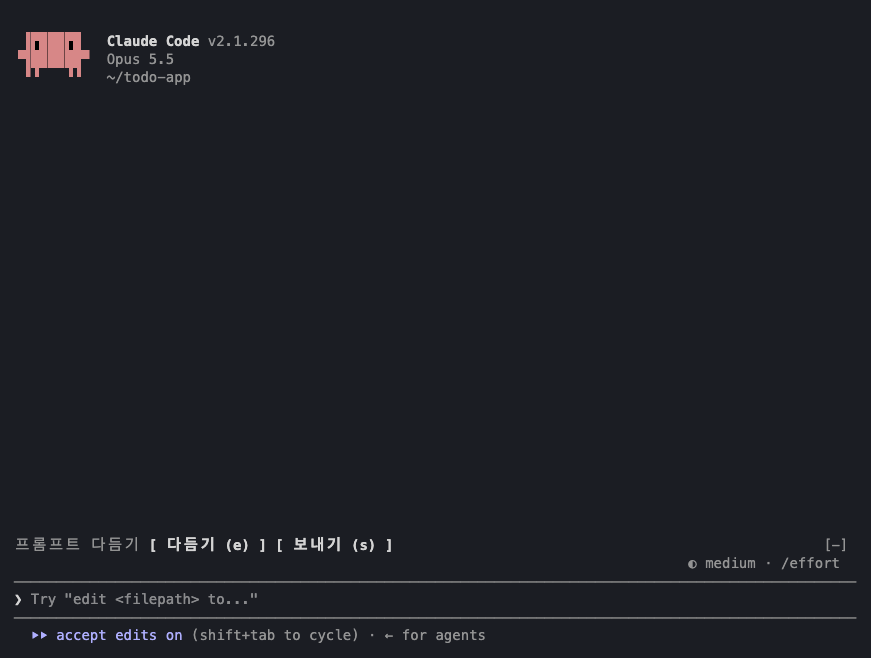
</p>

## 목차

- [왜 필요한가요](#왜-필요한가요)
- [mod 6종 한눈에 보기](#mod-6종-한눈에-보기)
- [쓰기 전과 후 (before / after)](#쓰기-전과-후-before--after)
- [설치 가이드](#설치-가이드)
- [사용 가이드](#사용-가이드)
- [비용과 필요 조건](#비용과-필요-조건)
- [문제 해결](#문제-해결)
- [mod 고치기](#mod-고치기)
- [라이선스](#라이선스)

## 왜 필요한가요

Claude Code는 강력하지만, 한국어로 하루 종일 쓰다 보면 비슷한 곳에서 자꾸 걸려요.

| 자주 겪는 일 | 그래서 생기는 문제 | 도와주는 mod |
|---|---|---|
| "이거 고쳐줘"처럼 짧게 던지게 돼요 | Claude가 범위와 완료 기준을 멋대로 정해요 | **prompt-enhancer** |
| 답에 ESM, CommonJS, rebase 같은 말이 설명 없이 섞여 나와요 | 답을 다시 물어보느라 시간이 들고, 아는 척 넘어가면 나중에 사고가 나요 | **plain-talk** |
| Claude가 날짜 형식, 명령 이름 같은 걸 혼자 정하고 넘어가요 | 한참 뒤에 "이게 왜 이렇게 됐지?"를 발견해요 | **assumption-tracker** |
| 작업하다 보인 다른 문제를 Claude가 함께 고치거나, 답 끝에 말로만 남겨요 | 변경이 커져 검토가 어렵거나, 말로 남긴 건 스크롤 위로 사라져 잊혀요 | **idea-shelf** |
| 터미널에 Claude 세션을 여러 개 띄워 둬요 | 어느 세션이 나를 기다리는지 창을 하나씩 열어 봐야 알아요 | **session-monitor** |
| 같은 폴더에서 두 세션이 동시에 일해요 | 같은 파일을 서로 덮어써도 모르고 지나가요 | **session-tracker** |

여기에 한국어 사용자에게만 생기는 불편도 고쳤어요.

- **한글 폭**: 터미널에서 한글은 2칸을 차지해요. 줄 자르기·정렬을 글자 수가 아니라 화면 폭 기준으로 해서 표와 목록이 깨지지 않아요.
- **한글 입력 상태 단축키**: 한글 입력 중에는 `y`, `e` 같은 글자 단축키가 자모(`ㅛ`, `ㄷ`)로 들어가 먹지 않아요. 자주 쓰는 키는 숫자(`0`, `1`, `2`)로 바꿨어요.
- **조사 처리**: "결제가", "결제를", "결제에서"를 모두 "결제"로 알아봐서, 아이디어 매칭 같은 기능이 한국어 문장에서도 동작해요.

## mod 6종 한눈에 보기

| mod | 하는 일 | 시작 | 자세히 |
|---|---|---|---|
| **prompt-enhancer** | 대충 쓴 초안을 범위·순서·완료 기준이 있는 프롬프트로 다듬어 입력창에 넣어 줘요. 세션 모델의 프롬프트 가이드 카드도 반영해요. | 입력창 위 띠의 **다듬기 (e)** 또는 `/enhance <초안>` | [README](prompt-enhancer/README.md) |
| **plain-talk** (폴더 `basic-claude`) | 쉬운 한국어로, 그것만 읽어도 이해되게 답하게 해요. 답마다 작은 모델이 검사하고, 어려우면 한 번 다시 쓰게 해요. | `/plain` | [README](basic-claude/README.md) |
| **assumption-tracker** | Claude가 작업 중 정한 가정을 한 줄씩 기록해요. 맞음/틀림을 표시하면 정정이 Claude에게 가고, 프로젝트 규칙으로 남아요. | `0` 또는 `/assumptions` | [README](assumption-tracker/README.md) |
| **idea-shelf** | 작업 범위 밖의 곁가지는 손대지 않고 선반에 올려요. 나중에 버튼 하나로 Claude에게 넘겨요. | `/idea <내용>` | [README](idea-shelf/README.md) |
| **session-monitor** | 모든 폴더에서 돌고 있는 Claude 세션을 한 패널에 모아 "확인 필요 / 작업 중 / 완료"로 보여 줘요. 기다리는 세션에 바로 답장할 수 있어요. | `/monitor` | [README](session-monitor/README.md) |
| **session-tracker** | 같은 폴더의 다른 세션이 무엇을 했고 하는 중인지 보여 주고, 같은 파일을 고치면 경고해요. | `/tracker` | [README](session-tracker/README.md) |

## 쓰기 전과 후 (before / after)

아래 화면은 모두 데모용 빈 폴더의 작은 할 일 앱(`~/todo-app`)에서 실제로 Claude Code를 실행해 찍었어요. 왼쪽은 mod를 끈 상태, 오른쪽은 그 mod 하나만 켠 상태에서 같은 요청을 보낸 결과예요. Claude의 답은 매번 조금씩 달라요. 이미지를 누르면 크게 볼 수 있어요.

### prompt-enhancer — 대충 쓴 요청을 구체적으로

요청 초안: `done 명령이 이상해 고쳐줘`

<table>
<tr><th width="50%">mod 없이</th><th width="50%">prompt-enhancer 켜고</th></tr>
<tr>
<td>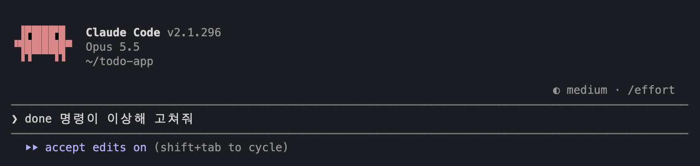</td>
<td>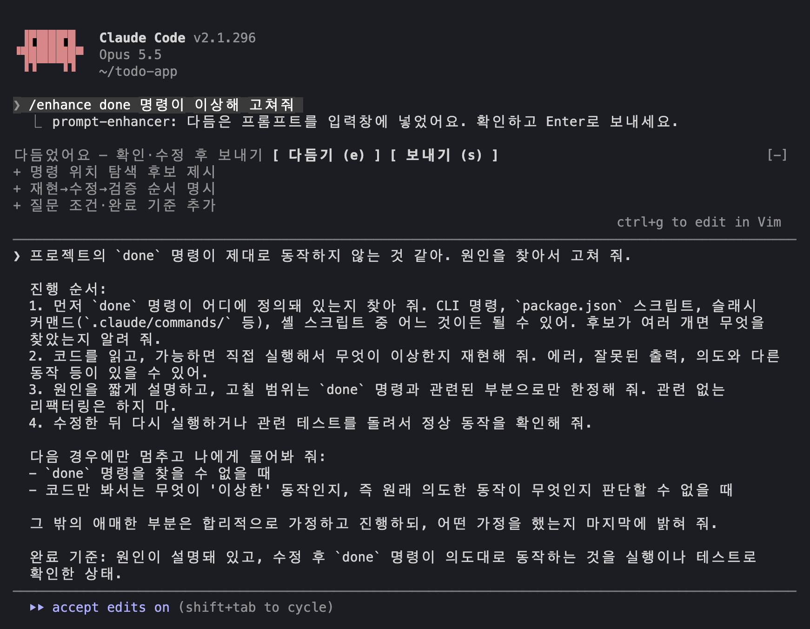</td>
</tr>
<tr>
<td>무엇이 이상한지, 어디까지 고칠지, 언제 끝난 건지 없이 그대로 보내게 돼요.</td>
<td>입력창 위 띠의 <b>다듬기 (e)</b>를 누르면 진행 순서, 막힐 때만 물을 것, 완료 기준을 넣어 입력창을 바꿔 줘요. 위 띠에 무엇을 더했는지 메모가 떠요. 고쳐서 보내거나 그대로 Enter(또는 <b>보내기 (s)</b>)를 누르면 돼요.</td>
</tr>
</table>

#### 쓰는 방법 두 가지

**방법 1 — 입력창에 쓰고 [다듬기 (e)] 누르기** (가장 간단해요)

평소처럼 입력창에 초안을 쓴 다음, 입력창 바로 위 띠의 **[ 다듬기 (e) ]** 를 클릭해요. 키보드로는 `ctrl+x tab`으로 띠에 들어가 `e`나 `Enter`를 눌러요(한글 입력 상태라면 `Enter`가 편해요). 아래 화면이 이 방법이에요.


**방법 2 — `/enhance <초안>` 명령**

명령 한 줄로 바로 다듬어요. 길게 붙여 넣은 글은 입력창에서 `[Pasted text #1 +45 lines]`처럼 접혀 버튼으로는 읽지 못해요. 이때는 `/enhance ` 뒤에 붙여 넣으면 돼요.

<details open><summary>방법 2 화면 보기</summary>
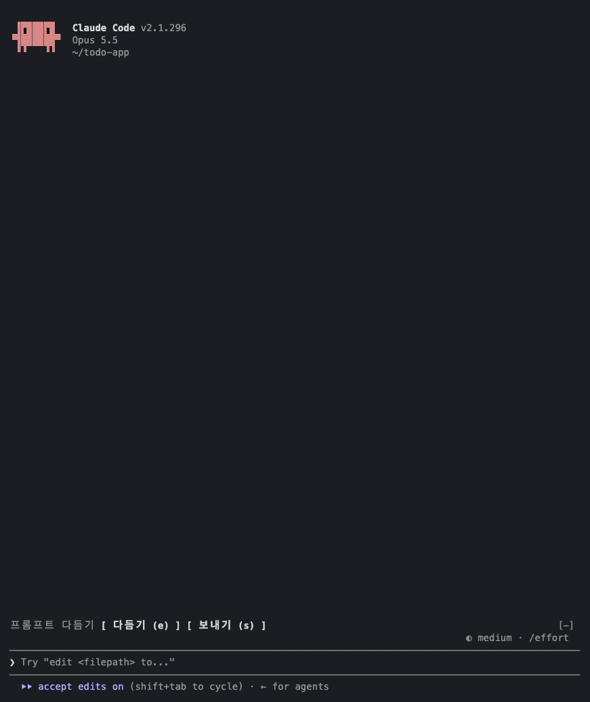
</details>

### plain-talk — 어려운 말 없이 답하게

요청: `package.json에 있는 "type": "module"은 뭐 하는 거야? 빼도 돼?`

<table>
<tr><th width="50%">mod 없이</th><th width="50%">plain-talk 켜고</th></tr>
<tr>
<td>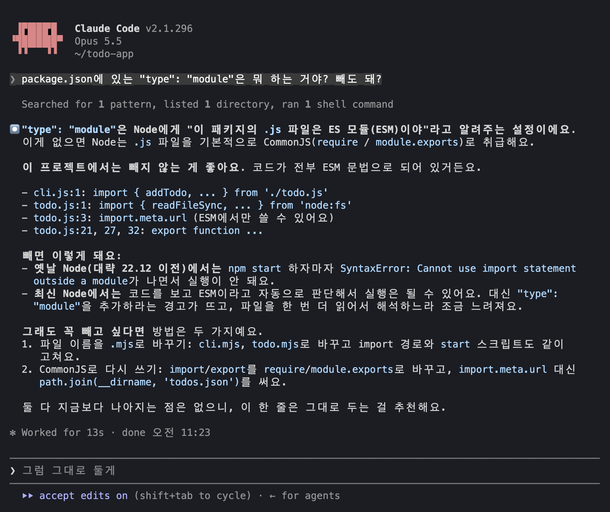</td>
<td>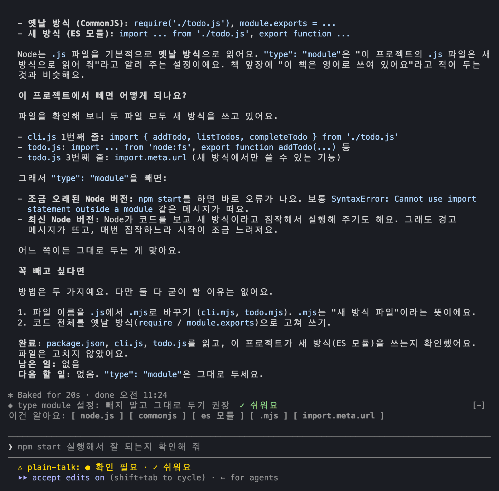</td>
</tr>
<tr>
<td>ES 모듈, CommonJS 같은 말이 설명 없이 나와요.</td>
<td>용어를 처음 나올 때 쉬운 말과 비유로 풀어요. 답이 끝나면 작은 모델이 검사해 <code>✓ 쉬워요</code>를 띄우고, 풀어 준 용어는 <b>이건 알아요</b> 버튼으로 "아는 용어"에 등록할 수 있어요.</td>
</tr>
</table>

<details open><summary>움직이는 화면 보기</summary>
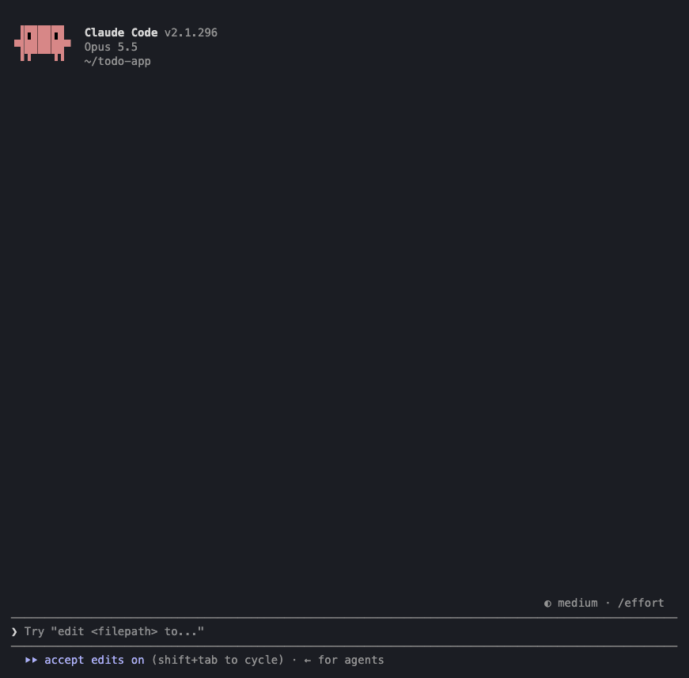
</details>

### assumption-tracker — Claude가 정한 가정을 눈앞에

요청: `할 일에 마감일을 넣을 수 있게 해 줘`

<table>
<tr><th width="50%">mod 없이</th><th width="50%">assumption-tracker 켜고</th></tr>
<tr>
<td>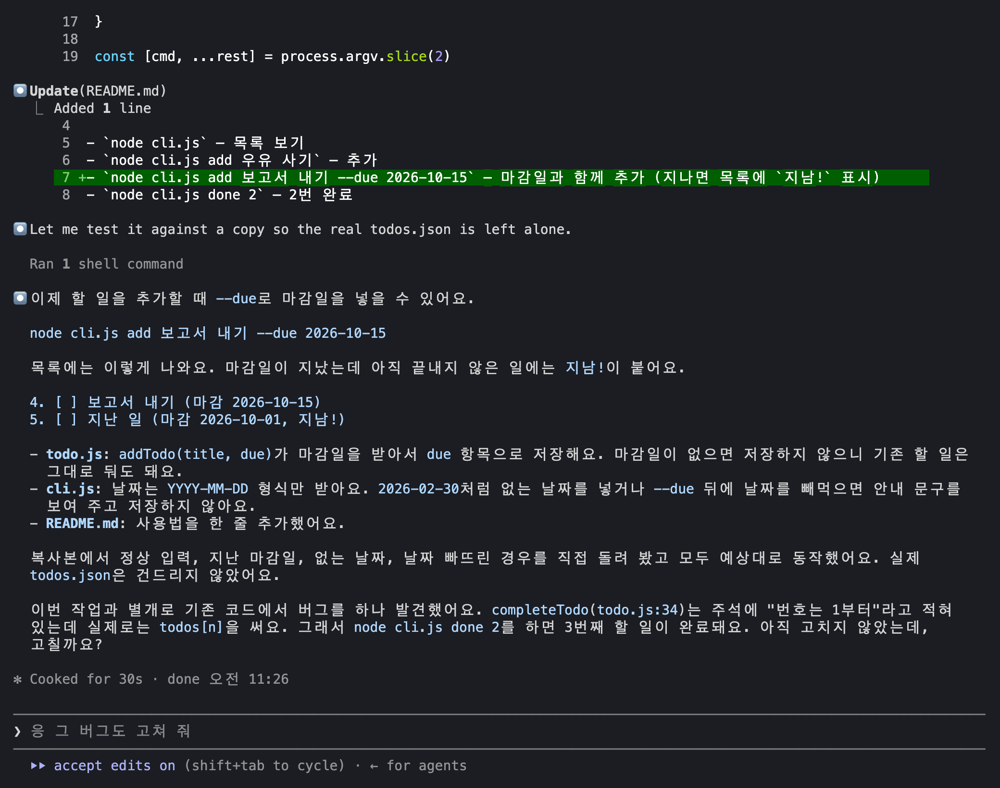</td>
<td>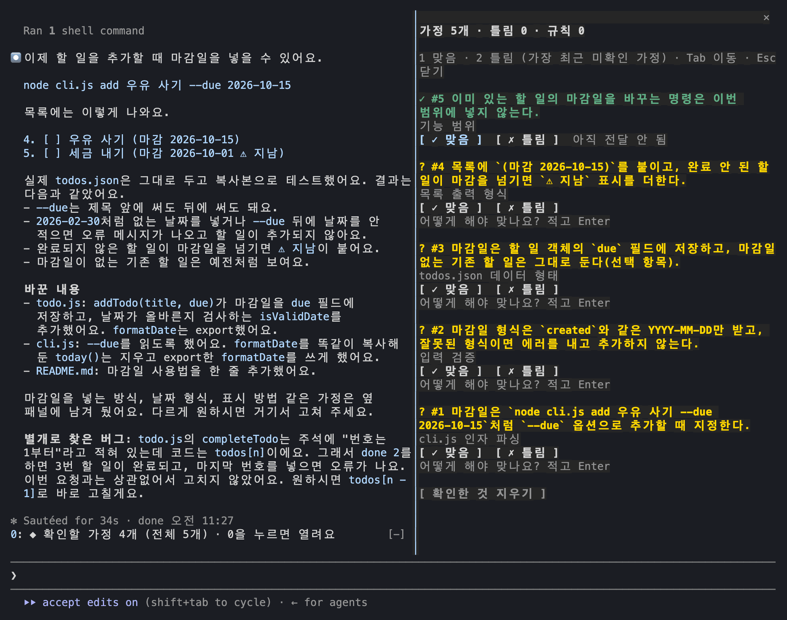</td>
</tr>
<tr>
<td>옵션 이름, 날짜 형식, 표시 방법을 Claude가 정했지만 긴 답 속에 섞여 있어 놓치기 쉬워요.</td>
<td>정한 가정이 옆 패널에 한 줄씩 쌓여요. <code>1</code>은 맞음, <code>2</code>는 틀림이고, 틀림에 고칠 방법을 적으면 Claude가 그 가정에 기댄 작업을 고쳐요. 정정은 프로젝트 규칙으로 남아 다음 세션에도 적용돼요.</td>
</tr>
</table>

<details open><summary>움직이는 화면 보기</summary>
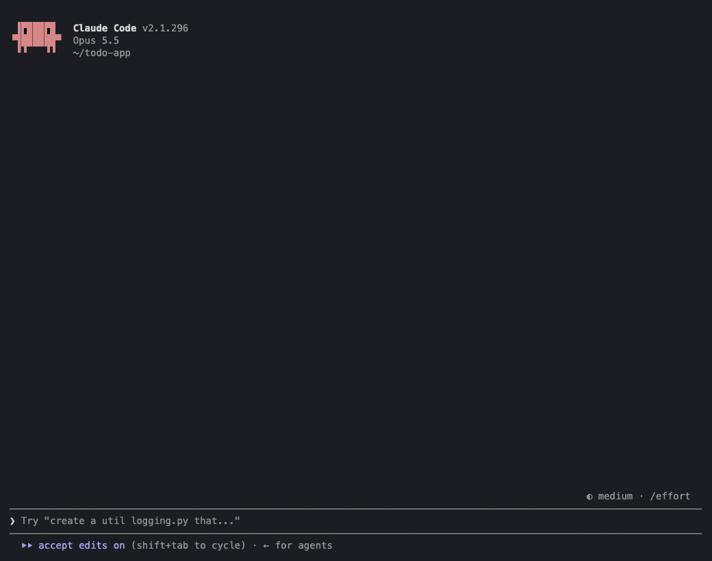
</details>

### idea-shelf — 곁가지는 선반에, 작업은 부탁한 만큼만

요청: `add 명령에서 제목이 비어 있으면 안내 메시지를 보여 줘` (이 앱에는 일부러 중복 코드와 번호 버그를 넣어 뒀어요)

<table>
<tr><th width="50%">mod 없이</th><th width="50%">idea-shelf 켜고</th></tr>
<tr>
<td>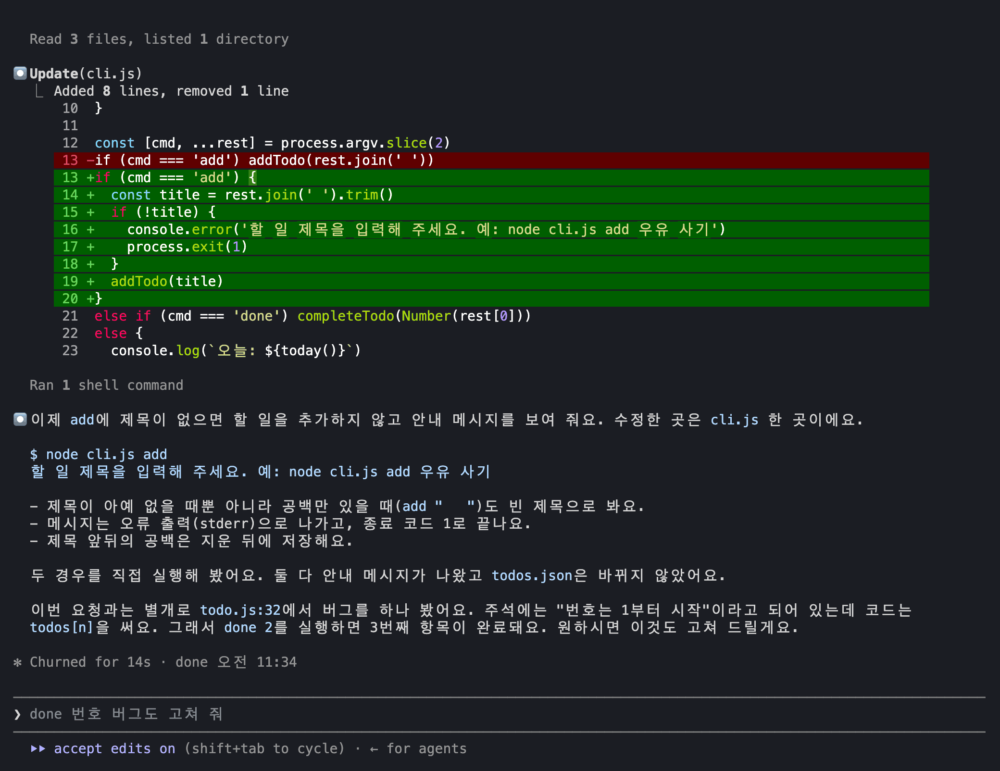</td>
<td>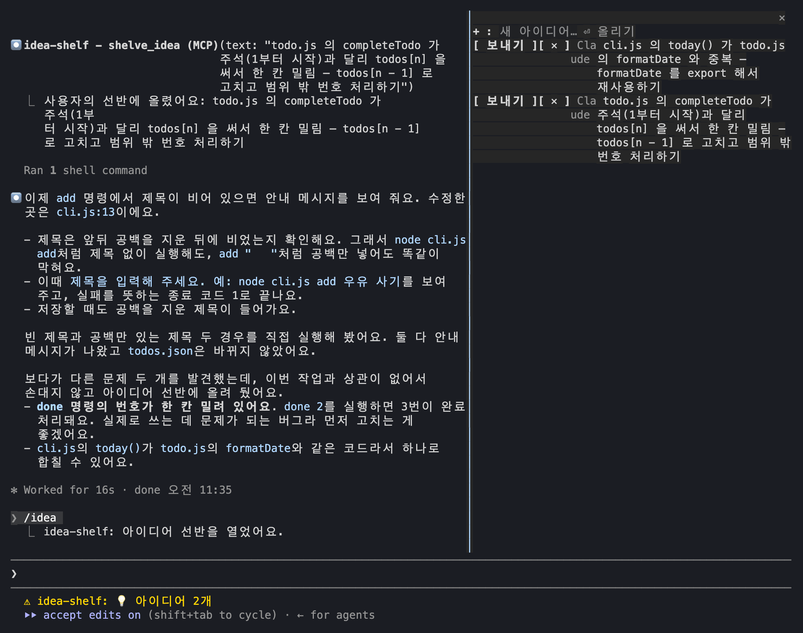</td>
</tr>
<tr>
<td>부탁한 일은 했지만, 발견한 버그는 답 끝에 말로만 남아요. 대화가 길어지면 스크롤 위로 사라져 잊히기 쉬워요. 그때그때 함께 고쳐 버려 변경이 커지기도 해요.</td>
<td>부탁한 것만 고치고, 발견한 곁가지(번호 버그, 중복 코드)는 <code>Claude</code> 표시와 함께 선반에 올려요. 상태 줄에 <code>💡 아이디어 2개</code>가 남고, 선반에서 <b>보내기</b>를 누르면 그때 Claude에게 넘어가요.</td>
</tr>
</table>

<details open><summary>움직이는 화면 보기</summary>
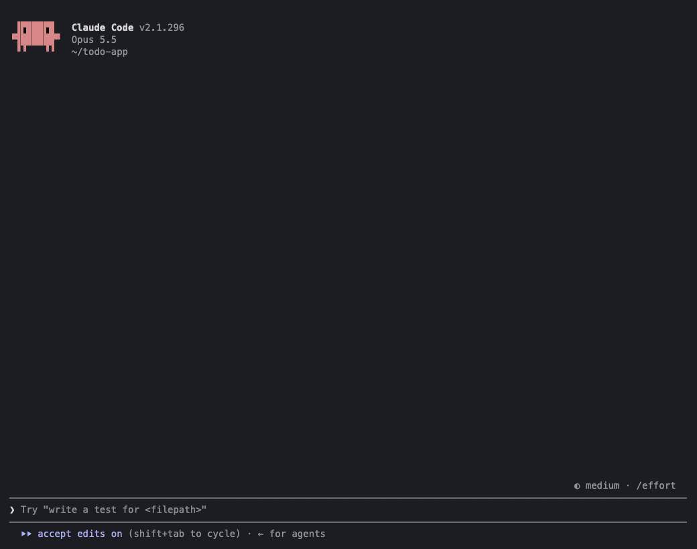
</details>

### session-monitor — 모든 세션을 한 패널에서

상황: 다른 폴더까지 포함해 Claude 세션 3개가 돌고 있어요. 하나는 끝났고, 하나는 내 선택을 기다리고, 하나는 작업 중이에요.

<table>
<tr><th width="50%">mod 없이</th><th width="50%">session-monitor 켜고</th></tr>
<tr>
<td>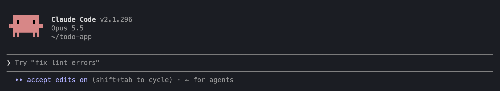</td>
<td>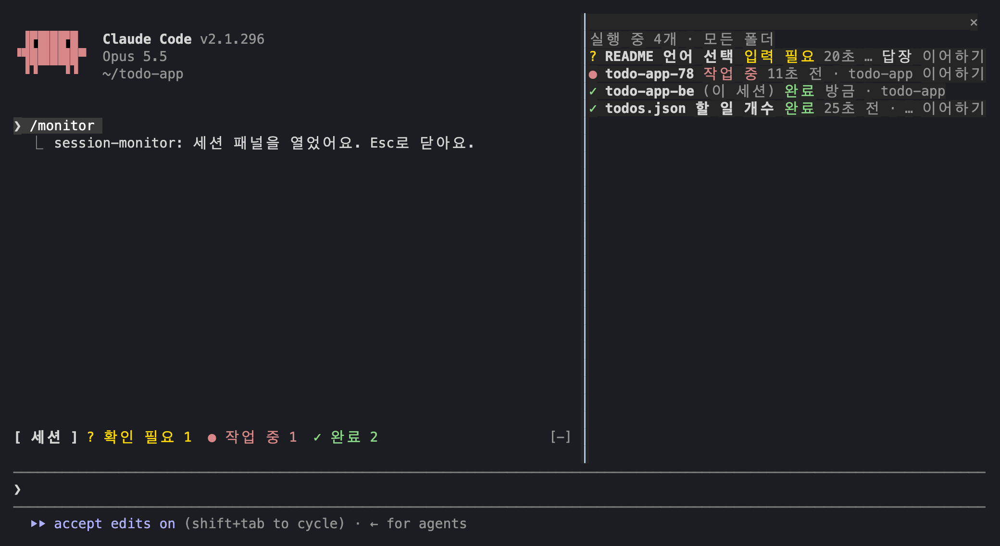</td>
</tr>
<tr>
<td>지금 창에서는 다른 세션이 무엇을 하는지, 나를 기다리는지 알 수 없어요. 창을 하나씩 열어 봐야 해요.</td>
<td>입력창 위 띠에 <code>? 확인 필요 · ● 작업 중 · ✓ 완료</code> 개수가 늘 보여요. <code>/monitor</code>를 열면 세션마다 상태, 기다리는 이유, 폴더가 나오고, 기다리는 세션에는 <b>답장</b>을, 다른 세션은 <b>이어하기</b>로 이어 갈 수 있어요.</td>
</tr>
</table>

<details open><summary>움직이는 화면 보기</summary>
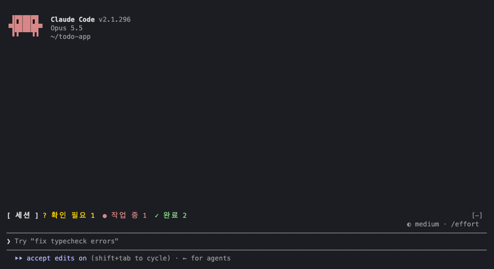
</details>

### session-tracker — 같은 폴더의 다른 세션과 충돌 경고

상황: 같은 폴더에서 세션 A가 `todo.js`에 함수를 더한 뒤, 세션 B가 같은 파일을 고쳐요. 화면은 세션 B예요.

<table>
<tr><th width="50%">mod 없이</th><th width="50%">session-tracker 켜고</th></tr>
<tr>
<td>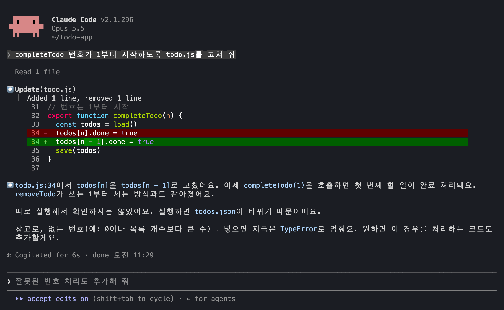</td>
<td>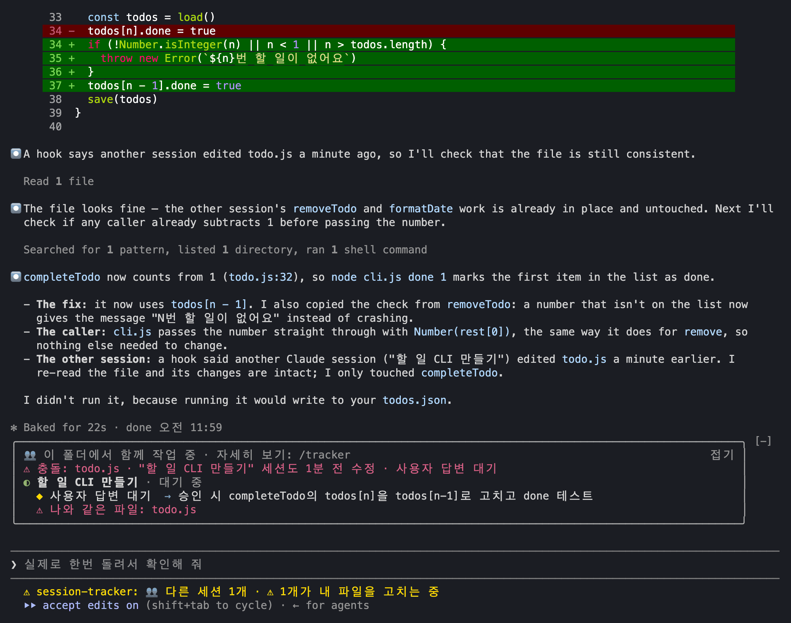</td>
</tr>
<tr>
<td>다른 세션이 1분 전에 같은 파일을 고쳤다는 걸 모른 채 수정해요.</td>
<td>입력창 위에 같은 폴더 세션의 제목·상태·다음 할 일이 보이고, 같은 파일을 고치면 <code>⚠ 충돌</code> 경고가 떠요. Claude에게도 "다시 읽고, 그 세션의 변경은 그대로 두라"는 안내가 붙어요.</td>
</tr>
</table>

<details open><summary>움직이는 화면 보기</summary>
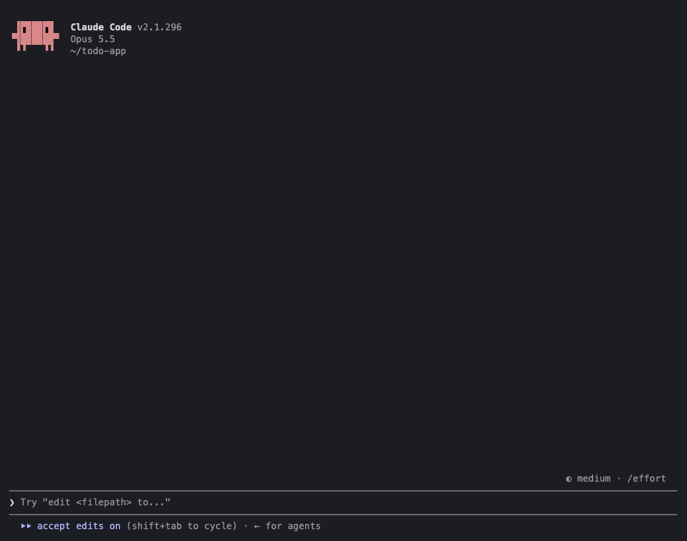
</details>

## 설치 가이드

### 1. 준비

1. **Claude Code 버전 확인** — 2.1.295 이상이어야 해요.
   ```
   claude --version
   claude update        # 낮으면 올려요
   ```
2. **설정 하나 확인** — `~/.claude/settings.json`의 `env`에 `CLAUDE_CODE_ATTRIBUTION_HEADER: "0"`이 있으면 지워요. 있으면 mod가 따로 부르는 모델 호출이 `429`로 막혀요([문제 해결](#문제-해결) 참고).
   ```
   grep -n CLAUDE_CODE_ATTRIBUTION_HEADER ~/.claude/settings.json   # 아무것도 안 나오면 괜찮아요
   ```
3. **터미널에서 진행** — 설치 명령은 터미널의 Claude Code에서만 받아요. 데스크톱 앱의 Code 탭에서는 쓸 수 없지만, 터미널에서 `user` 범위로 설치하면 데스크톱 앱의 로컬 세션에서도 켜져요.

### 2. 설치

터미널에서 `claude`를 실행하고, 입력창에 원하는 mod를 한 줄씩 입력해요.

```
/plugin install prompt-enhancer --marketplace robinade/claude-mods-ko
/plugin install plain-talk --marketplace robinade/claude-mods-ko
/plugin install assumption-tracker --marketplace robinade/claude-mods-ko
/plugin install idea-shelf --marketplace robinade/claude-mods-ko
/plugin install session-monitor --marketplace robinade/claude-mods-ko
/plugin install session-tracker --marketplace robinade/claude-mods-ko
```

1. 처음 한 번은 `Add marketplace?`(`github:robinade/claude-mods-ko`)를 물어요. `y`를 눌러요.
2. 설치 범위를 고르는 화면에서 맨 위의 `user`에 두고 Enter를 눌러요. `user` 범위는 이 컴퓨터의 모든 프로젝트에서 켜져요.
3. `Installed <mod>. Plugin is now active.`가 나오면 끝이에요. 그 세션에서 바로 켜지고, 이후 여는 세션에서도 켜져요.

터미널 명령으로 6종을 한 번에 설치할 수도 있어요.

```
claude plugin marketplace add robinade/claude-mods-ko
for m in prompt-enhancer plain-talk assumption-tracker idea-shelf session-monitor session-tracker; do
  claude plugin install $m@claude-mods-ko
done
```

`claude`를 감싸는 래퍼(예: cmux) 안에서 `plugin` 하위 명령이 거부되면, `which -a claude`로 실제 실행 파일을 찾아 그걸로 실행하세요(예: `~/.local/bin/claude`).

### 3. 잘 깔렸는지 확인

```
claude plugin list        # 6개가 @claude-mods-ko 로 보이고 enabled 이면 성공
```

새 세션을 열고 아래를 하나씩 입력해 봐요.

| 입력 | 이렇게 되면 정상 |
|---|---|
| 입력창에 `로그인 버그 고쳐줘`를 쓰고 띠의 **다듬기 (e)** (또는 `/enhance 로그인 버그 고쳐줘`) | 다듬은 프롬프트가 입력창에 들어오고, 띠에 무엇을 더했는지 메모가 떠요 |
| `/plain` | 지금 수준(기본 `초보`)과 아는 용어 개수가 나와요 |
| `/assumptions` | 옆에 가정 패널이 열려요 |
| `/idea 테스트 아이디어` | 선반에 올라가고 상태 줄에 `💡 아이디어 1개`가 떠요 |
| `/monitor` | 실행 중인 세션 목록 패널이 열려요 |
| `/tracker` | 같은 폴더 세션 패널이 열려요 |

### 4. 업데이트

```
claude plugin marketplace update claude-mods-ko
claude plugin update prompt-enhancer@claude-mods-ko
```

- 첫 줄은 이 레포의 최신 mod 목록을 받아 와요. 둘째 줄은 mod 하나를 새 버전으로 바꿔요. 업데이트할 mod마다 둘째 줄을 실행해요.
- 업데이트한 뒤에는 Claude Code를 다시 시작해요.

### 5. 끄기·켜기·지우기

```
claude plugin disable <이름>@claude-mods-ko
claude plugin enable <이름>@claude-mods-ko
claude plugin uninstall <이름>@claude-mods-ko
```

### 설치 없이 한 세션만 써 보기

```
git clone https://github.com/robinade/claude-mods-ko
claude --plugin-dir claude-mods-ko/session-monitor
```

## 사용 가이드

### 공통

- **명령**: `/`를 치면 mod 명령이 기본 명령과 같이 보여요. 명령 이름은 영어지만 뒤에 붙이는 내용은 한국어로 써도 돼요.
- **입력창 위 띠(밴드)와 버튼**: 입력 중에는 키가 입력창으로 가요. `ctrl+x tab`(또는 띠 클릭)으로 띠에 포커스를 옮기고, `Tab`으로 버튼 사이를 이동, `Enter`로 누르고, `Esc`로 입력창에 돌아가요.
- **한/영 전환 주의**: 버튼의 글자 단축키(`e`, `s` 등)는 한글 입력 상태에서는 자모(`ㄷ`, `ㄴ`)로 들어가 동작하지 않아요. 영문 상태로 바꾸거나 `Tab`+`Enter`, 클릭을 쓰세요. 숫자 단축키는 입력 상태와 상관없이 동작해요.
- **옆 패널**: `/monitor`, `/tracker`, `/idea`, `/assumptions`는 대화 옆에 패널을 열어요. 패널이 열리면 키 입력이 패널로 가요. `Esc`로 닫아요. 터미널 폭이 좁으면 패널이 바로 안 보일 수 있어요.
- **저장되는 것**: 규칙, 아이디어, 아는 용어, 프롬프트 기록은 프로젝트별로 `~/.claude/plugins/store/`에 저장돼서 재시작해도 남아요. session-tracker는 `~/.claude/session-tracker/`에 세션 기록을 남겨요. 이 기록은 컴퓨터마다 따로 쌓이고, 다른 컴퓨터로 옮겨지지 않아요.

### mod별 핵심

| mod | 자주 쓰는 것 | 알아 두면 좋은 것 |
|---|---|---|
| [prompt-enhancer](prompt-enhancer/README.md) | 띠의 **다듬기 (e)** / **보내기 (s)** · `/enhance <초안>` | 길게 붙여 넣은 글은 `/enhance ` 뒤에 붙여 넣어요. 고쳐서 보낸 기록을 보고 다음 다듬기 길이를 맞춰요. 모델별 프롬프트 카드는 `prompt-enhancer/cards/`에 있어요. |
| [plain-talk](basic-claude/README.md) | `/plain 초보` · `/plain 전문가` · `/plain 끄기` · `/plain know <용어>` | 작업한 턴은 답을 **완료 / 남은 일 / 다음 할 일**로 끝내요. 아는 용어로 등록하면 더 풀지 않아요. |
| [assumption-tracker](assumption-tracker/README.md) | `0` 또는 `/assumptions` · 패널에서 `1` 맞음 / `2` 틀림 | 틀림에 고칠 방법을 적고 Enter를 누르면 정정이 Claude에게 가고 프로젝트 규칙이 돼요. |
| [idea-shelf](idea-shelf/README.md) | `/idea <내용>` · `/idea` | 방금 한 작업과 맞는 아이디어가 있으면 `💡` 줄로 알려 줘요. 모델 호출 없이 단어 겹침으로 비교해요. |
| [session-monitor](session-monitor/README.md) | `/monitor` · 띠의 **세션** 버튼 | **이어하기**는 `cd <폴더> && claude --resume <id>`를 클립보드에 복사해요. **답장**은 기다리는 세션에 메시지로 보내요. |
| [session-tracker](session-tracker/README.md) | `/tracker` · 띠의 **접기/펼치기** | 같은 파일을 최근 30분 안에 다른 세션이 고쳤으면 경고해요. 서브에이전트가 고친 파일은 추적하지 않아요. |

## 비용과 필요 조건

- **Claude Code 2.1.295 이상.** mod 기능은 아직 미리보기(early access) 단계라 Claude Code 버전에 따라 동작이 바뀔 수 있어요.
- **모델 호출 비용.** 일부 mod는 대화와 별도로 모델을 불러요. 그만큼 사용량이 늘어요.
  - prompt-enhancer: 다듬을 때마다 세션 모델을 한 번 불러요.
  - plain-talk: 답변마다 작은 모델(haiku)로 한 번 검사하고, 실패한 답변은 Claude가 한 번 더 써요. 아끼려면 `/plain 전문가`나 `/plain 끄기`.
  - session-tracker: 턴이 끝날 때마다 haiku로 세션 요약을 한 번 만들어요.
  - assumption-tracker, idea-shelf, session-monitor는 따로 모델을 부르지 않아요.
- **plain-talk 알림 소리**: 소리 파일은 저작권 때문에 레포에 넣지 않았어요. 넣는 방법은 [plain-talk README](basic-claude/README.md#알림-소리)에 있어요.

## 문제 해결

| 증상 | 원인 | 해결 |
|---|---|---|
| 다듬기·답변 검사·세션 요약이 `429`로 실패하고, 메시지에 `CLAUDE_CODE_ATTRIBUTION_HEADER`가 보여요 | `~/.claude/settings.json`의 `env`에 `CLAUDE_CODE_ATTRIBUTION_HEADER: "0"`이 있어요. mod가 따로 부르는 모델 호출은 Claude Code 머리말을 빼고 보내요. 이 값이 `0`이면 Claude Code 요청이라는 표시가 하나도 남지 않아서 구독 로그인 요청이 막혀요. 본 대화는 멀쩡해요. | 그 줄을 지우고 새 세션을 여세요. Anthropic API에 직접 연결하면 캐시에 영향이 없어요([공식 문서](https://code.claude.com/docs/en/llm-gateway-protocol#system-prompt-attribution-block)). |
| 다듬기 버튼이 "붙여 넣은 긴 글은 접혀 있어…"라고 해요 | 긴 붙여넣기는 입력창에 `[Pasted text #1 +45 lines]`로 접히고, 원문은 보낼 때만 펼쳐져요. | `/enhance ` 뒤에 붙여 넣고 Enter를 누르세요. |
| 띠의 단축키가 안 먹어요 | 한글 입력 상태라 글자 키가 자모로 들어가요. | 영문으로 바꾸거나 `ctrl+x tab` → `Tab` → `Enter`, 또는 클릭하세요. |
| `plugin` 명령이 "not run from this spelling"이라며 거부돼요 | `claude`가 다른 프로그램(예: cmux)의 래퍼예요. | `which -a claude`로 실제 실행 파일을 찾아 그걸로 실행하세요. |
| plain-talk 알림 소리가 안 나요 | 알림 소리 파일은 레포에 없어요. 소리 없이도 상태 줄과 띠는 그대로 동작해요. | [plain-talk README](basic-claude/README.md#알림-소리)를 보세요. |
| 그 밖의 문제 | | `claude --debug-file <파일>`로 실행하고, 기록에서 `$.model.`이나 mod 이름으로 찾아보세요. mod의 훅이 실패하면 대화에 mod 이름과 이유가 흐린 줄로 표시돼요. |

## mod 고치기

레포를 받아서 고쳐요. 각 mod의 코드는 `<폴더>/hooks/register.tsx`에 있어요.

```
git clone https://github.com/robinade/claude-mods-ko
claude --plugin-dir ./claude-mods-ko/prompt-enhancer
```

- 둘째 줄은 고친 mod를 그 세션에서만 켜서 확인해요. 같은 mod를 GitHub에서 설치해 둔 컴퓨터라면, 겹치지 않게 먼저 `claude plugin disable <이름>@claude-mods-ko`로 꺼 두세요.
- 고친 판을 계속 쓰려면 그 폴더를 로컬 마켓플레이스로 등록해요: `claude plugin marketplace add ./claude-mods-ko`. 같은 이름(`claude-mods-ko`)의 마켓플레이스는 하나만 둘 수 있어서, GitHub 판을 등록한 컴퓨터에서는 이 방법을 쓰지 마세요. 로컬로 설치하면 고친 뒤 열려 있는 세션에서 `/reload-plugins`로 바로 다시 불러와요.
- 확인 명령:
  ```
  claude plugin validate ./claude-mods-ko
  cd claude-mods-ko && claude plugin test ./<폴더>
  ```
- 다른 컴퓨터가 새 버전으로 받게 하려면, 고친 mod의 `.claude-plugin/plugin.json`에서 `version`을 올린 뒤 올려 주세요.

## 라이선스

[MIT](LICENSE)
